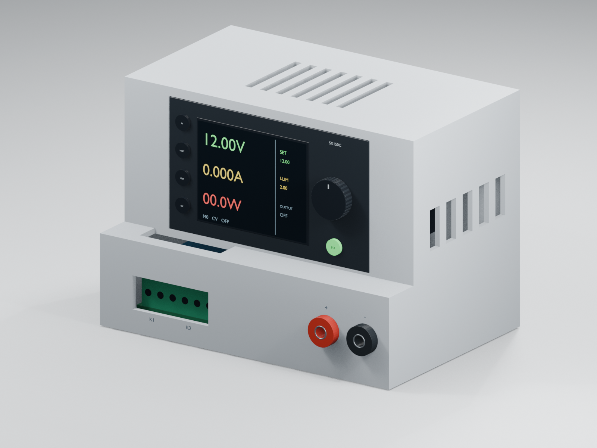

# Type-C 可调直流电源

这是一套由 USB Type-C PD 供电的可调直流电源。PD 20 V 同时供电给 SX150C 和 ESP32 双路继电器板。ESP32 经 HW-221 电平转换与 SX150C 通信，Windows 客户端可通过 CH340E 有线串口或 BLE 控制主输出及两路继电器。整机输入预算为 100 W，初始输出设定按 75 W 目标验证。

[3D 打印模型与打印配置（MakerWorld）](https://makerworld.com.cn/zh/models/3324172-sx150c-type-c-ke-diao-zhi-liu-dian-yuan-wai-ke)

## 主要功能

- **连接与输出控制**：Windows 客户端支持 CH340E USB 有线连接和蓝牙 BLE，可调节输出电压、限流，独立控制主输出和 K1、K2 两路继电器。
- **记忆组与保护**：切换 M0～M10 时先关闭主输出。每组可设置名称和备注，并配置过压（OVP）、过流（OCP）、过功率（OPP）保护阈值。
- **时序控制**：按步骤设置等待时间及 K1、K2、主输出的开关动作。下拉选择即载入，点击「运行」才执行。时序保存为 EXE 同级 `sequences/` 下的 JSON。
- **实时曲线与 CSV**：电压、电流、功率分三轨显示，共用时间轴。支持滚轮缩放、拖动框选区间查看峰值和平均功率，以及导出采样数据。
- **悬浮与托盘**：半透明置顶小窗显示实时读数和开关，主窗口收起后可从系统托盘恢复。
- **诊断与升级**：通过 USB 导出固件诊断日志，无需拆外壳。Windows 客户端和 ESP32 固件可分别检查更新。

> 点击「停止」只取消后续动作，不会自动关闭主输出或释放继电器。固件 v1.2.1 起，断开连接也不会自动关断。

## 下载

| 文件 | 用途 |
| --- | --- |
| [Windows 客户端 v1.1.0 · PowerModule-PC.exe](https://github.com/chuckie0329/power_module/releases/download/pc-v1.1.0/PowerModule-PC.exe) | Windows x64 便携版 |
| [ESP32 固件 v1.2.6 · PowerModule-ESP32.bin](https://github.com/chuckie0329/power_module/releases/download/fw-v1.2.6/PowerModule-ESP32.bin) | 通过客户端升级 |
| [ESP32 固件 v1.2.6 · PowerModule-ESP32.hex](https://github.com/chuckie0329/power_module/releases/download/fw-v1.2.6/PowerModule-ESP32.hex) | 通过 UART0 下载口烧录 |

[全部发布](https://github.com/chuckie0329/power_module/releases) · [客户端使用说明](pc_client/README.md) · [固件与烧录说明](firmware/README.md) · [硬件接线表](docs/简化硬件接线表.md)

## 模块与配件采购

以下为 [MakerWorld 外壳项目](https://makerworld.com.cn/zh/models/3324172-sx150c-type-c-ke-diao-zhi-liu-dian-yuan-wai-ke#profileId-3930826) 列出的淘宝原链接。选购时可对照[模块规格与尺寸](modules/README.md)。

| 模块或配件 | 淘宝 |
| --- | --- |
| SX150C 数控升降压电源模块 | [商品链接](https://item.taobao.com/item.htm?id=862021442751) |
| ESP32-WROOM-32E 双路继电器板（5–60 V 供电版） | [商品链接](https://item.taobao.com/item.htm?id=672666360807) |
| Mini PD3.1 Type-C 诱骗模块 | [商品链接](https://item.taobao.com/item.htm?id=1067224413274) |
| HW-221 / TXS0108E 电平转换板 | [商品链接](https://item.taobao.com/item.htm?id=575223989976) |
| 紫色 CH340E Type-C USB 转串口板 | [商品链接](https://item.taobao.com/item.htm?id=967672205574) |
| 红黑香蕉插座 | [商品链接](https://item.taobao.com/item.htm?id=909723612339) |

## 项目目录

| 目录 | 内容 |
| --- | --- |
| `docs/` | [电子设计书](docs/Type-C可调直流电源详细设计书.md) · [接线表](docs/简化硬件接线表.md) · [UART 接线](docs/串口模块接线.md) |
| `firmware/` | ESP32 固件、USB 和 BLE 协议、构建与升级说明。 [固件说明](firmware/README.md) |
| `pc_client/` | Windows 客户端 Python 源码及打包说明。 [客户端说明](pc_client/README.md) |
| `modules/` | 模块尺寸、实物图、原厂资料和 PD 网页归档。 [模块资料索引](modules/README.md) |
| `tools/` | PD 网页归档和电子设计资料校验脚本。 [设计资料校验](tools/verify_design.py) |

## 验证资料

在项目根目录运行 `python tools/verify_design.py`，可校验设计书中的 Modbus 示例、PD 归档校验和及资料的本地链接。 [设计验证记录](docs/验证记录.json)

## 许可证

本项目自有的 ESP32 固件与 Windows 客户端源代码采用 MIT 许可证。第三方依赖与厂商资料适用各自的条款。 [MIT 许可证](LICENSE)
