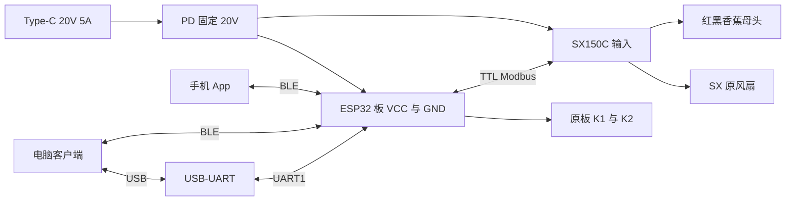

# Type-C 供电可调直流电源详细设计书

版本 V1.5　修订日期 2026 年 11 月 11 日

本版以 PD、SX150C 和 ESP32 三个模块为核心，新增 CH340E 和 HW-221 两块通信板：PD 固定协商 20V，正负极并联给 SX150C 输入与 ESP32 板的 VCC/GND；ESP32 通过 TTL Modbus 设置 SX 的电压、电流限值和 ON/OFF，并独立控制原板两个继电器。Windows 客户端支持 BLE 和 USB-UART 连接，固件提供 BLE GATT 接口供移动客户端接入。

SX 输出直接接红黑香蕉母头。补充件为紫色 CH340E Type-C 子板、HW-221 电平转换板、线束和连接件。CH340E 默认 5V TTL，通过 HW-221 转为 ESP32 的 3.3V。输出启停和电源保护由 SX 原模块执行，整机输入功率通过开发测试时的外部仪表验证。

100W 定义为包含自身耗电的 Type-C 供电预算。按 SX 损耗和控制板耗电，首版输出目标为 75W，电压 0.50～40.00V、电流最高 8A，三者同时受限。80W 仅作为实测后可评估的档位；不将 100W 输入宣传成 100W 输出。

## 1 需求与实现

| 需求 | 硬件与软件实现 |
| --- | --- |
| 100W 包含自身消耗 | 固定配套的 20V 5A 充电器、5A E-Marker 线和 PD 模块；输出先限制到 75W，并用外部功率表验证整机输入 |
| 两个继电器 | 原板 K1、K2，GPIO16、17 独立控制，使用原板接线端子 |
| 手机与电脑无线 | ESP32 片上 BLE，统一 GATT 服务 |
| 电脑有线 | 紫色 CH340E + HW-221，映射至 ESP32 UART1 |
| 调整电压和电流 | ESP32 UART2 控制 SX150C，电流设置是 CC 限值，不是强制负载吸收指定电流 |
| 关闭直流输出 | SX 本机按键或串口 ONOFF；关断结果以模块回应和实际测量为准 |

本机为单路正电压非隔离电源，正常调压下限为 0.5V。关闭输出不等于即时消除电容残压，放电时间须实测。固件和 Windows 客户端已有可运行版本。整机额定功率及散热仍待实测。 [固件](../firmware/README.md) · [Windows 客户端](../pc_client/README.md)

## 2 现有模块的依据与限制

### 2.1 PD 诱骗模块

本地整理见 [PD 模块资料](../modules/PD诱骗模块/资料整理.md) 和 [离线详情](../modules/PD诱骗模块/网页资料离线版.html)。网页标称尺寸 13 × 10 × 4mm、最大电流 5A，A、B 两版通过焊盘选择固定电压。

本项目固定选择 20V。A 款只短接 4，B 款只短接 1。输入不是靠 PD 模块连续调压；电压和限流均由后面的 SX150C 实现。禁止接 48V；不使用 36V 顶格输入。PD 失败可能回退到低电压，固件可读取 SX 的 UIN 寄存器确认输入电压，再发送输出开启命令。

这个模块未公开可供 ESP32 读取的 PDO、协商电流、线缆身份或 Power Good 接口。因此高功率模式只能用于已经验证并固定配套的充电器和线材。若后续要求自动识别任意充电器的可用功率，应将其换成可读取 PD 合同的受电控制方案，不能用电压检测替代合同读取。

### 2.2 ZK-SK150C 数控升降压模块

项目目录名和文件名使用 SX150，PDF 正文型号为 **ZK-SK150C**，下文统称 SX150C。依据为 [SX150C 原始说明书](../modules/SX150/SX150C.pdf)，重要页面如下。

| 项目 | 说明书标称或描述 | 对整机的影响 |
| --- | --- | --- |
| 输入 | 7～36V | 固定 20V 适用；48V 会超压 |
| 输出 | 0.5～40V，0～8A，150W | 150W 为模块标称，整机仍受 100W 输入限制 |
| 效率 | 约 88% | 必须预留转换损耗与散热 |
| 显示分辨率 | 电压 0.01V，电流 0.001A | 不等同于串口设定分辨率 |
| 标称精度 | 电压 ±0.3% 加 3 个字；电流 ±0.5% 加 3 个字，可校准 | 需用台表和负载验证，不能把分辨率当精度 |
| 通信 | TTL 串口，Modbus RTU，功能码 03、06、10 | ESP32 可以读写；不是 RS232 或 RS485 电气接口 |
| 保护 | 欠压、过压、过流、过功率、过温等 | 必须重新设置，不能沿用 160W 等出厂保护值 |
| 开机状态 | 可设置默认关闭 | 首次上电前先人工设置关闭，再由软件核验 |

PDF 第 1 页文字写外形 83 × 48 × 48mm，但同页示意图标出了 25mm 深度，存在不一致。安装前测量散热器、端子和插线后的总深度，并预留接线空间。安装开口图给出主开口 78 × 44mm、侧卡扣处总宽 81mm、耳位高度 12mm；安装时应预留装配间隙并确认耳位垂直位置。

新增 [背面实物参考图](../modules/SX150/外观图3.png) 显示模块自带风扇，原风扇接 SX 自己的插座，不接 ESP32 的 5V 轨。侧面组合端子按图中方向从上到下标为 `+5V、TX、RX、GND、温度检测−、温度检测+`，上四位为通信部分；实际方向仍以丝印和通断核对为准。`+5V` 标注不能证明 TX/RX 是 5V 信号，也不能证明可给整个 ESP32 板供电。另见 [尺寸图](../modules/SX150/尺寸简图.png) 与 [开口参考](../modules/SX150/外观图1.png)。

第 5～7 页为协议表和报文示例。说明书列出的电流编码为 10mA/计数。实机 `MODEL=4008`、`VERSION=100` 的限流寄存器读回为 1mA/计数，ESP32 固件 v1.0.1 对应适配。客户端电流设置步进为 10mA。

### 2.3 ESP32 双路继电器板

依据为 [原厂板卡说明](../modules/ESP32双路继电器模块(5-60V版本)/艾尔赛ESP32双路继电器模块.doc)、[原理图](../modules/ESP32双路继电器模块(5-60V版本)/原理图/ESP32_Relay%20X2(303E32DC210).pdf) 和 [原有测试程序](../modules/ESP32双路继电器模块(5-60V版本)/测试程序/ESP32_IO_TEST/ESP32_IO_TEST.ino)。

| 项目 | 已确认信息 | 设计处理 |
| --- | --- | --- |
| 主控 | ESP32-WROOM-32E，板卡说明称 4MB Flash | 复用片上 BLE 和硬件 UART，无需外接蓝牙模块 |
| 两个继电器 | GPIO16、GPIO17，高电平吸合 | 两路均独立用于外设 |
| 板载 LED | GPIO23 | 用作设备运行或故障指示 |
| 板尺寸 | 74.3 × 48.1mm | 原板带三个安装孔 |
| 供电表述 | 标题写 5～60V，功能说明写 7～60V | 根据原理图区分 VCC 高压入口与独立 5V 引脚 |
| 降压电路 | XL7005A 生成 5V，再用 ASM1117 类器件生成 3.3V | 保留原板稳压，20V 接高压 VCC，验证 5V 余量 |
| 下载接口 | UART0、GPIO0、EN、5V、GND | 保留为维护接口，不与正常 USB 控制混用 |

新增 [ESP32 控制板尺寸图](../modules/ESP32双路继电器模块(5-60V版本)/ESP32控制板尺寸图.webp) 给出三个 Ø3mm 安装孔，横向孔距 69.3mm、纵向 43.1mm，边距 2.5mm。以原图左下角为原点，孔中心为 (2.5,2.5)、(71.8,2.5)、(2.5,45.6)；右上角没有第四孔。本方案使用这三孔固定，并在板载端子处补无焊点边缘支撑。

当前支撑修订：端子侧原两处承托块为4×2×6mm，保持外侧边界，厚度只向PCB内侧增加；根部各加向板内延伸2mm、高出底板2mm的三角加强筋。在端子侧PCB边缘沿板面向内5mm处，另加两处4×4×6mm短支撑，分别对齐原块，不跨成整条。底板2mm、承托面z=8mm及原三孔位置不变。新增块覆盖板边内5～9mm区域，真实焊脚和焊点位置尚未完整测量，试装须先检查PCB能否自然平放，不可强压拧紧。

20V 位于原板说明的 7～60V 高压供电范围，可直接接 VCC 和 GND。主方案保留原板，不默认拆 L1、R1、U2，也不默认外置 5V。SX 自带风扇由 SX 自身供电，不能据额外机箱风扇的耗电否定并联供电方案。

原理图中的 XL7005A 额定输出为 0.4A，见 [XLSEMI 手册](https://www.xlsemi.com/datasheet/XL7005A-EN.pdf)。BLE、双继电器、LED 和 USB 桥的电流仍须合并核对，20V 入口允许的电流不能当作内部 5V 的能力。正常运行先关闭 Wi-Fi，仅启用 BLE。先验证 5V 总持续电流及瞬态压降、3.3V、温升和复位情况；验证不合格时先调整供电实现，不以大电容代替持续电流能力。

原理图不含 USB 桥，ESP32-WROOM-32E 本身也没有本方案所需的原生 USB 设备接口，因此电脑有线连接增加 USB-UART 桥。ESP32 三路 UART 及 GPIO 映射能力见 [Espressif UART 文档](https://docs.espressif.com/projects/esp-idf/en/stable/esp32/api-reference/peripherals/uart.html)。

### 2.4 香蕉插座

项目的 [尺寸图](../modules/香蕉头/香蕉头尺寸图.png) 标有 Ø8.0 ±0.1mm 开孔和 MAX 10A，但实物图中的绝缘结构与尺寸图外形不能完全对应。必须测量实际插座的绝缘肩、螺母、夹持厚度和尾部空间，并确认这两个插座之间及其与面板螺钉之间没有导电连接。

## 3 功率预算与工作范围

### 3.1 预算定义

```text
P_total_input = P_SX_input + P_controller_and_wiring
P_output ≈ η_SX × (P_total_input − P_aux)
I_set_max = min(8A, 75W / V_set)
```

两路并联供电共用总计 5A，不能各取 5A。η_SX 按 SX 完整输入与其输出功率测量，包含显示、自带风扇和转换损耗。P_aux 首版预算取 5W，包括 ESP32 原板及继电器约 3W、USB 桥约 0.4W、线路约 0.4W、其余约 1.2W 余量；这是预算分配，不是板载 5V 可以输出 5W。

| 工况 | 估算 |
| --- | --- |
| 75W 输出，85% 预算效率，5W 自耗预留 | 75/0.85+5 ≈ 93.2W 输入 |
| 80W 输出，88% 参考效率，5W 自耗预留 | 80/0.88+5 ≈ 95.9W 输入 |
| 100W 输入，88% 参考效率，5W 自耗预留 | (100−5)×0.88 ≈ 83.6W 输出，尚未留足裕量 |

88% 来自模块说明书近似值，85% 是设计预算假设，都不能代替实测效率。75W 是初始输出功率目标，不是任意工况下整机必定低于 100W 的测量保证。本版没有实时整机输入功率闭环：固件检查设定值乘积，SX 自带 OPP 按输出功率保护；入口总功率用外置仪表在全工况验证。测试仪表不安装进设备。

固定采用经验证的 20V 5A 供电组合。更换充电器、线材或多口充电器的分配状态后，重新核对供电能力；不能仅凭 UIN 显示 20V 就认定可取 5A。SX LVP 初值约 18V，正常轮询中读到电压异常时固件尝试发 OFF，其效果仍依赖串口正常工作。

### 3.2 75W 输出包络

| 输出电压 | 最大设定电流 | 对应最大功率 |
| --- | --- | --- |
| 0.50V | 8.00A | 4.0W |
| 3.30V | 8.00A | 26.4W |
| 5.00V | 8.00A | 40.0W |
| 9.00V | 8.00A | 72.0W |
| 12.00V | 6.25A | 75.0W |
| 15.00V | 5.00A | 75.0W |
| 20.00V | 3.75A | 75.0W |
| 24.00V | 3.12A | 74.88W |
| 30.00V | 2.50A | 75.0W |
| 40.00V | 1.87A | 74.8W |

电流向下取整到协议步进 0.01A。8A 是模块标称上限，低压大电流时接触电阻、线损及温升仍需验证。超出包络的命令明确拒绝；不在后台悄悄改成不同的电流值。

## 4 直接连接结构



PD 正极分别接 SX IN+ 和 ESP32 VCC，负极分别接 SX IN−和 ESP32 GND。SX OUT+、OUT−直接接香蕉母头，原风扇保持模块内部接线。所有非隔离信号共地，电脑 USB 接入后也可能与电脑地相连，因此输出不属于隔离浮地电源。

## 5 实际接线

### 5.1 电源和输出

| 起点 | 终点 | 接线要求 |
| --- | --- | --- |
| PD + | SX IN+ | 主功率线建议 AWG18，按实测温升与压降选定 |
| PD − | SX IN− | 与正线相同载流能力 |
| PD + | ESP32 VCC | 20V 高压输入，不接 5V、3V3 或 GPIO |
| PD − | ESP32 GND | 在分配处共地，不让大电流经过信号地线 |
| SX OUT+ | 红色香蕉母头 | 输出线建议 AWG16，短线并采用压接或可靠焊接 |
| SX OUT− | 黑色香蕉母头 | 与正线匹配，保持极性 |

控制板原有稳压与继电器驱动保持不变。BLE 正常工作时关闭 Wi-Fi。按第 2.3 节验证板载 5V 电流、3.3V 谷值及温升，不额外给风扇或外设从这条 5V 轨取电。

### 5.2 HW-221 与 SX 串口

新增 HW-221 / TXS0108E：VA 接 ESP32 板 3V3，VB 接 ESP32 板 5V，GND 共地。OE 接内部 GPIO27 并以 10kΩ 下拉，上电先保持禁用，UART 初始化及电源稳定后使能。HW-221 说明书标明 PCB 26.3×16.24mm、两个 Ø3.776mm 孔及 20.7mm 孔距。

若 SX 串口实测为 5V：GPIO18 TX → A1/B1 → SX RX，SX TX → B2/A2 → GPIO19 RX。若为 3.3V，SX 两线直接与 ESP32 同电平交叉连接，不经 5V B 侧；对应 A1/A2/B1/B2 留空。SX 的 +5V 通信引脚不作为主供电，也不与 ESP32 板的稳压 5V 并接。

VA/VB 必须对应各自信号电平；不向 TXS 信号线增加强上拉，也不沿用旧直连方案的 1kΩ 串联电阻。连线尽量短。OE 仅使串口高阻，拉低 OE 不表示 SX 输出已关闭。SX 温度和保护信息仍从其原通信读取，不增加传感器。

### 5.3 CH340E USB 有线控制

明确选用紫色 Type-C CH340E，PCB 16×17mm，四孔 Ø2mm，商品参数标称 5V TTL。GPIO32/UART1 TX 接 HW-221 A3，经 B3 到 CH340E RXD；CH340E TXD 接 B4，经 A4 到 GPIO33/UART1 RX。v1.1.7 起 UART1 使用 921600、8N1。DTR、板端 3V3 留空，不接 EN / GPIO0，UART0 保留维护用途。

**本接线采用机内统一供电。** CH340E 的板上 5V 和 HW-221 VB 均取 ESP32 板的 5V，VA 取其 3V3。必须先隔离 CH340E 的 USB VBUS→板上 5V 通路，再接内部 5V；未确认隔离前不能并接。该条件参考 CH340 原厂手册 §7.6，具体断点须拿到实物测通断，本文没有执行改线。保持 D+、D−、GND 和 Type-C CC 网络，不要求只插电脑 USB 时启动整机。若保留商品板原状、使用电脑 VBUS 供电，则需重新划分转换器供电域，不能照搬共用 VB 的四路接法。

完整连接表、OE 控制、供电条件及固定初值见 [新增串口模块接线与固定方案](串口模块接线.md)。实物阶段确认 C-C 线枚举、收发波形、掉电行为与原板 5V 负载，新增耗电计入自身功耗预算，75W 初始输出目标保持。

### 5.4 两路继电器

K1 和 K2 使用原板端子，不拆焊，分别由 GPIO16、17 高电平吸合，低电平释放。NC、COM、NO 的物理次序按丝印与通断表核对。客户端只报告线圈命令，没有触点反馈时不宣称触点已闭合或没有粘连。

首版继电器使用按 DC30V 内、1A 以下阻性控制负载验证；最终触点和 PCB 载流能力按实物型号、温升及负载类别确认。40V 主输出直接接香蕉母头，不通过这两个继电器。对感性外设按其要求处理反电动势，设备仅连接符合上述额定值的直流负载。

## 6 控制与通信引脚分配

排针号来自原理图，实物 1 脚方向先核实，再按网名接线。

| 功能 | GPIO | 原理图排针 |
| --- | --- | --- |
| K1 | 16 | P2 12，已板载 |
| K2 | 17 | P2 11，已板载 |
| SX UART2 TX | 18 | P2 9，经 HW-221 A1/B1 接 SX RX（SX为5V时） |
| SX UART2 RX | 19 | P2 8，经 HW-221 A2/B2 接 SX TX（SX为5V时） |
| USB UART1 TX | 32 | P1 7，经 HW-221 A3/B3 接 CH340E RXD |
| USB UART1 RX | 33 | P1 10，经 HW-221 A4/B4 接 CH340E TXD |
| 内部电平转换使能 | 27 | 按原板网名接 HW-221 OE，10kΩ 下拉，不引出外部接口 |
| 板载 LED | 23 | P2 2 |
| 维护 UART0 | 1、3 | P4 TXD0、RXD0 |

未分配的原板引脚保持不外接，不作为外设控制接口。GPIO34～39 为输入脚，不能当输出；GPIO6～11 连接 Flash，不使用；GPIO0、2、5、12、15 涉及启动配置，不让外设影响其启动电平。UART2 重映射到 18、19，避免与已板载的继电器引脚 16、17 冲突。

## 7 SX150C Modbus 协议

### 7.1 帧与通信策略

ESP32 初始配置为地址 1、9600 8N1。实机已在地址 1、115200 8N1 下连续读回有效状态。重新接入 SX150C 时用面板菜单核对地址和速率，通过 ESP32 的 UART0 维护口配置后复位。 [固件联调说明](../firmware/README.md)

Modbus RTU 采用 CRC16，初值 FFFF、多项式 A001，CRC 低字节先发，寄存器地址和寄存器数据高字节先发。主机只允许一帧在途。9600 下帧间留至少 5ms；115200 下按不小于 1.75ms 起步。超时初设 200ms，一次失败可重试一次，连续 3 次失败或 1s 无有效状态时报告通信异常并尝试写 SX OFF；没有有效回应时把 SX 输出标为未知，不能显示为已关闭。

### 7.2 核心寄存器

以下地址均为零起始十六进制协议地址，不使用 40001 形式偏移。

| 地址 | 名称 | 权限 | 编码及用途 |
| --- | --- | --- | --- |
| 0000 | V-SET | 读写 | 电压 V ×100，例如 12V 为 1200 |
| 0001 | I-SET | 读写 | `MODEL=4008`、`VERSION=100` 为 1mA/计数，面板 2.000 A 对应 2000。其他版本按说明书的 10mA/计数处理 |
| 0002 | VOUT | 只读 | 电压读数 ÷100 V |
| 0003 | IOUT | 只读 | 当前按说明书的 10mA/计数解码，实机非零编码待带载核对 |
| 0004 | POWER | 只读 | 功率读数 ÷10 W |
| 0005 | UIN | 只读 | 输入电压读数 ÷100 V |
| 000D 和 000E | T_IN 和 T_EX | 只读 | 温度字段与页面其他温度字段的小数位不一致，先对照屏幕验证 |
| 000F | LOCK | 读写 | 0 未锁，1 锁定按键 |
| 0010 | PROTECT | 只读 | 保护状态枚举 |
| 0011 | CVCC | 只读 | 0 CV，1 CC |
| 0012 | ONOFF | 读写 | 0 关闭，1 开启 SX 输出 |
| 0016 和 0017 | MODEL 和 VERSION | 只读 | 识别型号和固件，建立兼容记录 |
| 001D | EXTRACT-M | 读写 | 0～10，调出数据组，可能同时改变输出状态 |
| 0052 | S-LVP | 数据组读写 | M0 欠压阈值，V ×100 |
| 0053 | S-OVP | 数据组读写 | M0 过压阈值，V ×100 |
| 0054 | S-OCP | 数据组读写 | M0 过流保护，A ×100 |
| 0055 | S-OPP | 数据组读写 | M0 过功率保护，W ×10 |
| 005C | S-OTP | 数据组读写 | M0 过温阈值，说明书标一位小数及 F/C，需确认温标与编码 |
| 005D | S-INI | 数据组读写 | M0 上电输出状态，设为关闭并断电复验 |
| 005E | S-O_CLOSE | 数据组读写 | M0 的时长、容量、能量开关及调出输出状态，固件用 `0x0100` 检查 M-OUT |

M0～M10 起始地址为 `0x0050 + 组号×0x10`。使用默认 M0 时应只写必要设置，并核对其实际生效行为。不要在后台高频写数据组、保护参数、校准或保存参数，以免引发非预期输出变化或 Flash 磨损。

初次配置建议：SX 开机输出关闭；LVP 约 18V；OPP 按当前配置设为 75.0W；OTP 先保持 60℃；OCP 根据目标最大电流及模块特性设置，区分 CC 电流设置和故障型 OCP。40V 输出时 OVP 可按 41V 起步，仍需实际确认模块是否稳定以及外设允许电压。出厂默认 160W OPP 不适合本整机。

保护状态说明书枚举：0 正常，1 OVP，2 OCP，3 OPP，4 LVP，5 OAH，6 OHP，7 OTP，8 OEP，9 OWH，10 ICP，11 IVP。部分缩写与前页保护名称不一致；客户端保留原始状态码，未明确的代码显示“模块保护码 n”，不擅自解释。

### 7.3 可复核报文

```text
读取输出电压和电流   01 03 00 02 00 02 65 CB
设置电压 12.00V     01 06 00 00 04 B0 8A BE
打开 SX 输出        01 06 00 12 00 01 E8 0F
关闭 SX 输出        01 06 00 12 00 00 29 CF
```

上述报文 CRC 已按算法复算，与 PDF 中对应示例一致；实施中所有报文均由代码生成 CRC，避免手工修改数据后沿用旧校验码。工具脚本 [verify_design.py](../tools/verify_design.py) 可复核这些帧和功率表。

### 7.4 写入与输出开关顺序

主输出由 0012H 的 ONOFF 控制，SX OUT+、OUT−直接接到香蕉母头。开机先核对 SX 的上电输出关闭设置，再由 ESP32 发 SX OFF 并读回；设置电压、限流及模块自带的保护参数；只有用户明确开启时才写 SX ON 并读回。

改变参数前检查新电压与限流组合是否超过 75 W。主输出开启时先写需要降低的限流，再改电压，最后写需要提高的限流。自固件 v1.1.3 起，设定值读回一致且设备状态正常时保持输出开启。若 SX150C 触发保护并关断，ESP32 报告保护状态。写入结果无法确认时，ESP32 尝试发送 OFF 并读回。

SX 本机电源键继续按原模块功能开关输出。旋钮和预设组的变化通过读回同步到客户端。客户端可调出 M0～M10。固件确认目标组的 M-OUT 关闭后，先关主输出，再调出并读回目标组。重新开启时核对该组的 OPP 和上电输出状态。

SX 的保护状态寄存器是只读信息，不增加未经说明书确认的清故障寄存器。保护发生后显示原码，在条件消失并按模块支持的方式解除后，才接受新的开启操作。

## 8 固件与实际状态

固件的源码、编译配置、烧录和联调步骤见 [ESP32 固件说明](../firmware/README.md)。

固件使用硬件 UART0 维护、UART1 USB、UART2 Modbus，BLE 与 USB 命令进入同一个执行队列。首版保持 Wi-Fi 关闭，依赖版本在开发时固定。

| 任务 | 建议方式 | 内容 |
| --- | --- | --- |
| SX 轮询 | 约 100～200ms，单帧在途 | 目标值、实际 V/I/P、UIN、保护、CV/CC 和 ONOFF |
| 参数执行 | 事件驱动 | 检查范围与 75W 设定包络，写入并读回 |
| 两路继电器 | 事件驱动 | 初始化低电平释放，之后按各自绝对通断目标设置 |
| USB 与 BLE | 事件驱动 | 限长解析、命令入队及状态推送 |
| 配置保存 | 用户明确保存时 | 保存设定和配对信息，不自动恢复上次 ON |

开机先依赖 SX 已配置的上电输出关闭设置，ESP32 初始化后再发 OFF 并核对状态。电压、限流写后读回一致再报告成功，开启也须读回 ONOFF。实际输出和设定值分开显示；原板 LED 可表示连接或通信异常。

状态至少区分初始化、已同步关闭、输出运行、模块保护和通信状态未知。串口超时不能直接把软件期望的 OFF 当作已经关断。输出开启状态也可能由 SX 面板按键改变，轮询后如实更新。

USB 与已配对的 BLE 可并存，两端连接后均可直接下发命令。修改命令依次处理，重复请求按客户端标识和请求 ID 返回原结果，开关命令使用绝对通断值。

从固件 v1.2.1 起，客户端断开或失联时，主输出和继电器保持当前状态。显式发出 `all_off` 时，ESP32 释放 K1/K2，向 SX 发出 OFF 后读回。若 SX 未回应，主输出标为未知。ESP32 卡死或 SX 串口失效时，SX 可能保持最后输出，可通过 SX 面板键或断开 PD 输入处理。

## 9 蓝牙与有线客户端

### 9.1 蓝牙方式与平台

统一采用 BLE GATT：ESP32 为 Peripheral 和 GATT Server，手机 App、电脑客户端为 Central 和 GATT Client。现有 ESP32-WROOM-32E 支持 BLE，无需额外蓝牙转串口模块，也不额外占用控制 SX 的 UART。正常运行关闭 Wi-Fi，减少电源和无线共存压力。芯片能力见 [Espressif 数据手册](https://documentation.espressif.com/esp32-wroom-32e_esp32-wroom-32ue_datasheet_en.html)。

手机使用原生或包含原生 BLE 能力的 App，Android 调用系统 GATT API，iPhone 使用 Core Bluetooth；不把普通网页、通用串口调试 App 或手机设置中的“配对成功”当作完整客户端。电脑首版面向 Windows 10/11，提供 BLE 和 USB COM 两种连接模式，BLE 用系统 GATT API，USB 用串口 API。BLE 通常不会自动生成可直接使用的 COM 口。参考 [Apple Core Bluetooth](https://developer.apple.com/documentation/corebluetooth)、[Microsoft GATT 客户端](https://learn.microsoft.com/en-us/windows/apps/develop/devices-sensors/gatt-client)。

不以经典蓝牙 SPP 作为跨手机平台的统一实现。ESP32 同时具备经典蓝牙能力，但 iPhone 的普通自定义外设通信不应假定可直接走通用 SPP。BLE GATT 是本设计固定的互通接口；未来若增加 SPP，应另行暴露与测试，不能替代 BLE。

电脑可选 USB 或 BLE 连接。更换连接方式后，用户按需要重新开启输出。USB 与已配对的 BLE 使用同一套控制命令。

### 9.2 GATT 服务与传输

使用一个自定义 128 位服务及五个特征，下列 UUID 为项目自定义值，不冒用标准服务。

| 项目 | UUID | 属性和用途 |
| --- | --- | --- |
| 控制服务 | 4d505301-7e64-4d4a-9f80-021a56c11000 | 按服务 UUID 扫描和识别 |
| CMD | 4d505301-7e64-4d4a-9f80-021a56c11001 | Write with Response，提交命令分片 |
| RSP | 4d505301-7e64-4d4a-9f80-021a56c11002 | Indicate，返回最终执行与读回结果 |
| STATE | 4d505301-7e64-4d4a-9f80-021a56c11003 | Notify，推送状态快照，按链路容量降频 |
| INFO | 4d505301-7e64-4d4a-9f80-021a56c11004 | Read，协议版本、设备 ID、固件与能力 |
| HEARTBEAT | 4d505301-7e64-4d4a-9f80-021a56c11005 | Write with Response，固定 4 字节客户端标识，独立于长命令分包 |

广播名为 PM-xxxx，广播中包含服务 UUID。完成系统配对的客户端连接后订阅 RSP 和 STATE，读取 INFO 并校验协议版本，随后直接控制。SX 的执行结果以 RSP 中的写后读回为准，继电器响应报告线圈指令。

USB 与 BLE 复用同一 UTF-8 JSON 命令模型。USB 每条消息以换行结束，最大 1024 字节；BLE 对包含同一换行结束符的完整消息分片，不假定通知边界与消息边界相同。每个 BLE 分片带 8 字节头：版本 1 字节、标志 1 字节、消息号 2 字节小端、序号 1 字节、片数 1 字节、总消息长度 2 字节小端。有效分片载荷为 `min(ATT_MTU−3,512)−8`；MTU=23 时为 12 字节，不能直接写入一整段 JSON。

分片按顺序接收，校验消息号、总长度、片数、序号和最大 1024 字节，不合法即丢弃并返回协议错误。每连接至多保留一个命令重组缓冲，5 秒内未完成则清除。固件请求 MTU 247，支持协商至 MTU 23。

旧版 BLE 客户端的心跳使用独立 HEARTBEAT 特征，写入 4 字节小端 `client_id`。USB 使用携带相同标识的 JSON `heartbeat` 命令。v1.2.1 保留这些接口以兼容旧客户端。

USB 状态推送可设为 0.5、1、2、5 Hz，默认 2 Hz。从 v1.1.7 起，SX150C 使用 115200 波特时，USB 还可选 10、20 和 30 Hz。从 v1.1.8 起，BLE 协商的 ATT MTU 达 247 且 SX150C 串口为 115200 波特时也可选到 30 Hz。MTU 为 100～246 时最高 5 Hz，低于 100 时使用 0.4 Hz。常规推送到期时等待新的读数，控制应答优先。当前固件支持一个 BLE 中心连接。

### 9.3 命令与界面

控制消息包含客户端生成的 `client_id`、请求 ID、操作及参数，并使用 CRC32 发现分包或串口解析错误。CRC 对省略 crc32 字段、键按字典序排列、无空格、UTF-8 的 JSON 计算，字段为 8 位十六进制。输出设定电压与限流以整数 mV 和 mA 表示，均须为 10 的整数倍。示例省略 CRC。

```json
{"v":1,"id":101,"client_id":28,"op":"set_output","expected_rev":12,"args":{"voltage_mV":12000,"current_mA":2000,"enabled":false}}
{"v":1,"id":102,"client_id":28,"op":"set_relay","args":{"channel":1,"enabled":true}}
{"v":1,"id":103,"client_id":28,"op":"all_off","args":{}}
```

| 操作 | 内容 | 处理要求 |
| --- | --- | --- |
| get_info | 型号、固件、能力、功率配置 | 不触发输出 |
| get_state | 完整状态及时间戳 | 目标值、模块读回和故障原码分开 |
| set_stream_period | 设置推送周期 | 每链路独立生效 |
| set_output | 电压、限流、使能 | 校验修订号、功率及条件，写后读回 |
| set_relay | 指定 1 或 2 的绝对通断 | 不改另一通道 |
| select_group | 调出 M0～M10 | 检查 M-OUT，保持输出关闭并读回当前组 |
| set_protection | 写入过压和过流保护 | 主输出关闭后核对修订号，按当前组写入并读回 |
| set_opp | v1.1.3 支持写入过功率保护 0.1～100.0 W | 主输出关闭后核对修订号，按当前组写入并读回，步进 0.1 W |
| output_off | 关闭主输出 | 优先执行并读回 |
| all_off | SX OFF、继电器释放 | 优先执行并读回，SX 超时即标未知 |
| disconnect | 客户端主动断开 | v1.2.1 起设备维持输出和继电器状态 |
| heartbeat | 兼容旧客户端的连接心跳 | v1.2.1 起忽略心跳内容 |
| save_config | 保存 M0 的电压和限流 | 存入 ESP32 NVS，开机确认关闭后恢复 |

响应包含 id、ok、state_rev、applied、measured 和 fault。错误码包括 POWER_LIMIT、BAD_STEP、GROUP_RECALL_ON、REV_CONFLICT、INPUT_UNVERIFIED、SX_TIMEOUT、READBACK_MISMATCH、MODULE_PROTECT 和 BAD_FRAGMENT。超时显示“状态待确认”。

电脑和手机界面都显示SX 提供的输出 V/I/P、CV/CC、输入电压、已验证温度字段、保护原码、目标值与连接方式；输出开关与 K1/K2 独立操作，另有“全部关闭”。功率超限时明确拒绝并显示允许上限。继电器只显示线圈命令，没有触点反馈就不显示为已确认闭合。

### 9.4 配对与断线

使用固件 v1.1.5 时，设备上电且蓝牙空闲时可直接在电脑或手机上发起配对。首次配对输入固定 PIN **112233**。设备保存配对记录，客户端通过已配对的加密连接控制电源。

手机锁屏、App 后台或系统省电导致连接中断时，v1.2.1 起设备继续执行当前设定。客户端重连后读取主输出和继电器状态。

客户端不显示实测整机输入电流和输入总功率，因为本版没有相应传感器。get_info 中相应能力标为不支持；模块自带的 POWER 字段是输出功率，不是整机输入功率。最后一次有效读数同时显示采集时间，通信过期后不冒充当前读数。

## 10 简化版物料

| 物料 | 数量 | 说明 |
| --- | --- | --- |
| PD 诱骗模块 | 已有 1 | 固定 20V，核对 A/B 版焊盘 |
| SX150C | 已有 1 | 保留原风扇、面板及内部 CV/CC 与保护 |
| ESP32 双继电器板 | 已有 1 | VCC 20V，原稳压、继电器驱动不改 |
| 红黑香蕉母头 | 已有或补齐 1 对 | SX 输出直接接入 |
| USB-UART 子板 | 1 | 紫色 Type-C CH340E，16×17mm，5V TTL；统一供电前隔离 USB VBUS，孔距按用户反馈约12.6×10.3mm，距板边待核对 |
| UART 电平转换板 | 1 | HW-221 / TXS0108E，26.3×16.24mm |
| OE 下拉电阻 | 1 | 10kΩ，板上已有有效下拉时核实后不重复 |
| 电源线、端子、信号线 | 1 套 | 主功率线与控制线按各自电流选择 |
| 20V 5A PD 充电器与 5A 线 | 1 套 | 固定配套并实测确认 |

核对 HW-221 的 OE 下拉接线，并依据 SX150C 串口的实测电平选择是否转换。

## 11 异常时的处理能力

| 情况 | 本版行为 |
| --- | --- |
| SX 输出过流、过压、过功率或过温 | 由 SX 自身设置和保护执行，ESP32 读回原码并显示 |
| PD 输出电压不是正常 20V | 使用前测量；运行时可通过 SX UIN 发现异常并尝试发 OFF，不能读取 PD 合同电流 |
| 设定电压乘限流超过 75 W | 固件拒绝写入设定 |
| 客户端失联，ESP32 与 SX 串口正常 | v1.2.1 起保留主输出和继电器状态，重连后读回 |
| SX 串口失联 | 告知主输出未知，不能承诺自动关闭 |
| ESP32 卡死或复位 | SX 的当前状态由其自身保持或上电配置决定，不能承诺随 ESP32 失联关闭 |
| 继电器触点粘连 | 没有反馈检测，界面只能报告线圈命令 |
| 主输出关闭后的残压 | 按 SX 和外部负载电容实际放电时间确认 |

原模块标称输出防倒灌，不等同于已经验证任意电池或反向电压工况。相关负载需要单独测试，不用未经验证的能力替代接口条件。

## 12 硬件确认与验证

初次联调须完成以下硬件确认。

1. **供电与极性**：核对 PD A/B 版及 20V 焊盘，空载测量；确认 ESP32 接 VCC/GND、SX 接 IN+/IN−。原板 5V 不与 20V 或电脑 VBUS 混接。
2. **串口电平**：确定 SX 通信四位顺序和 TX 高电平，选择直连或必要电平匹配；读 MODEL、VERSION 和 ONOFF 后再测试写入。
3. **新增串口板**：核对紫色 CH340E 的 16×17mm 外形和四孔实际尺寸、VBUS 隔离位置、HW-221 OE 条件及两侧电源。先完成 UART 回环及 SX 收发；统一供电未确认前不能并接两路 5V。
4. **继电器与原板供电**：验证两继电器独立通断、上电释放，以及各组合与 BLE/USB 同时工作时的 5V/3.3V、电压纹波和温升。
5. **SX 参数**：上电输出关闭，初调 M0 的 OPP 设为 75 W、OTP 设为 60 ℃、LVP 约 18 V，按实际目标设置 OVP/OCP。调出其他组前核对 M-OUT，开启前核对各组保护。断电重启验证保存与本机按键行为。
6. **功能闭环**：电压电流多点写入读回、CC、两继电器、手机 BLE、电脑 BLE 和 USB，以及坏 CRC、重复请求、断线和重新连接。

功率与温升测试使用外置 PD 功率表或台式测量仪器，不把仪表并入设备。覆盖低压 8A、12V 6.25A、20V 3.75A、40V 1.87A 等允许工况，双继电器和 BLE/USB 同时工作，SX 风扇按原控制运行。记录整机输入功率、线损、端子、SX 和 ESP32 稳压器温度；效率或温升不满足预算时降低输出档位。

测试 UART 拔断和 ESP32 复位时，要记录 SX 的真实保留状态，客户端显示必须与可确认的数据一致，不能把“关闭命令已发送”当作物理输出已断。硬件确认后核对连接器和线束，并按最终装配状态进行温升与额定验证。

## 13 资料索引

| 资料 | 用途 |
| --- | --- |
| [PD 原网页](https://www.xinlucity.com/?s=resourcedetail/index/id/608.html) | 版本、焊盘和标称参数 |
| [PD 本地资料](../modules/PD诱骗模块/资料整理.md) | 离线说明和来源校验 |
| [SX150C 说明书](../modules/SX150/SX150C.pdf) | 第 1 页参数和开孔，第 4 页通信方式，第 5～7 页协议 |
| [ESP32 安装孔尺寸图](../modules/ESP32双路继电器模块(5-60V版本)/ESP32控制板尺寸图.webp) | 三孔、孔距及板外形 |
| [SX150C 新增背面图](../modules/SX150/外观图3.png) | 自带风扇和通信及温度端子标注 |
| [BLE 平台资料](https://docs.espressif.com/projects/esp-idf/en/stable/esp32/api-guides/ble/overview.html) | ESP32 的 GATT 与蓝牙栈 |
| [Apple Core Bluetooth](https://developer.apple.com/documentation/corebluetooth) | iOS App 与 BLE 外设通信 |
| [Windows GATT](https://learn.microsoft.com/en-us/windows/apps/develop/devices-sensors/gatt-client) | 电脑 BLE 客户端 |
| [ESP32 板卡说明](../modules/ESP32双路继电器模块(5-60V版本)/艾尔赛ESP32双路继电器模块.doc) | 外形、引脚和供电接口 |
| [ESP32 原理图](../modules/ESP32双路继电器模块(5-60V版本)/原理图/ESP32_Relay%20X2(303E32DC210).pdf) | 继电器控制、5V 电源、排针网络 |
| [ESP32 官方数据手册](https://documentation.espressif.com/esp32-wroom-32e_esp32-wroom-32ue_datasheet_en.html) | GPIO、电源和芯片约束 |
| [Espressif UART 文档](https://docs.espressif.com/projects/esp-idf/en/stable/esp32/api-reference/peripherals/uart.html) | 硬件 UART 及重映射 |
| [XL7005A 手册](https://www.xlsemi.com/datasheet/XL7005A-EN.pdf) | 板载降压额定电流 |
| [CP2102N 手册](https://www.silabs.com/documents/public/data-sheets/cp2102n-datasheet.pdf) | USB 桥供电和 VBUS 检测 |
| [TI Type-C 线缆说明](https://www.ti.com/lit/pdf/ssztbj8) | 高于 3A 时的线材条件 |

公开资料中的事实、工程预算和需要实测的条件已分别在对应章节说明。最终原理图、器件型号、固件版本和机械尺寸应随样机验证记录一起冻结。
