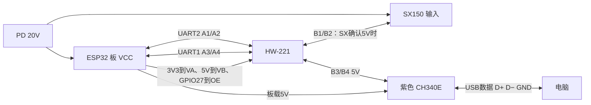

# 串口模块接线

硬件 V1.5 增加 HW-221 电平转换板和 CH340E USB 转串口板。

## 模块选择与关键前提

采用紫色 **CH340E Type-C 板**，不是旁边的 CH340C / CH9340C 黑板。图示 PCB 16×17mm、四孔 Ø2mm、标称 TTL 5V；其 3V3 引脚不能当作串口电平选择开关。电平转换板为 **HW-221 / TXS0108E**，26.3×16.24mm，实际两个 Ø3.776mm 安装孔，中心距 20.7mm，适用 M3 穿孔固定。

**本方案采用机内统一供电。** 为让一块 HW-221 同时转换两条 UART，CH340E 的 5V 与 HW-221 的 VB 均取自 ESP32 板的 5V。商品 CH340E 板通常把 USB VBUS 和 +5V 排针直接相连，因此必须先断开其 USB VBUS 到板上 5V 的供电通路，再接机内 5V；未确认隔离前不能直接并接。可以在板上断开供电路径，或使用已验证仅隔离 VBUS 的数据连接方式，保留 D+、D−、GND 和 Type-C CC 电路。具体改线点需要拿到实物用通断表确认，本文没有凭照片指定切割位置，也未执行实物改线。

上述接法依据 CH340 原厂手册 §7.6“连接单片机串口，统一供电”。若保留商品板原状由电脑 USB 供电，本方案的四路共用 VB 接法不能照搬，需要重新划分转换器供电域，不能把电脑 VBUS 与机内 5V 并接。CH340E 暂按机内供电设计，不要求只插电脑 USB 时整机启动。

SX150 的 +5V 引脚不能证明 TX/RX 的实际电平。下表中 SX 经 HW-221 的接法以 **SX 串口确认为 5V** 为前提；若实测为 3.3V，则 SX 两线直接与 ESP32 同电平交叉连接，不经过 5V B 侧；CH340E 两线仍通过 HW-221。

## 供电接线

| 起点 | 终点 | 说明 |
| --- | --- | --- |
| PD 20V + / − | SX IN+ / IN−，ESP32 VCC / GND | 保持原并联供电，不接新增板的电源脚 |
| ESP32 板 3V3 | HW-221 VA | A 侧 3.3V 逻辑参考 |
| ESP32 板 5V | HW-221 VB | B 侧 5V 逻辑参考 |
| ESP32 板 5V | CH340E 板 +5V / VCC | 仅在 USB VBUS 供电通路确认已隔离后连接 |
| ESP32 GND | HW-221 GND、CH340E GND、SX GND | 信号共地 |
| ESP32 GPIO27 | HW-221 OE | 内部使能，不增加外设输出接口 |
| HW-221 OE | 10kΩ → GND | 上电默认禁用；若板上已有有效下拉则核实后避免重复 |
| 不接 | CH340E 3V3、DTR | 不向 ESP32 供电，不连接 EN / GPIO0 |
| 不接 | SX 通信 +5V | 不与 ESP32 的稳压 5V 直接并接 |

CH340E、HW-221 的耗电计入原有自身功耗预算；75W 初始输出目标保持，板载 5V/3V3 和整机输入功率仍需实测。HW-221 两侧不是电气隔离，不能输入 20V。

## UART 接线表

| 通道 | A 侧（ESP32，3.3V） | B 侧（5V 外设） | 信号方向 |
| --- | --- | --- | --- |
| A1 ↔ B1 | GPIO18 / UART2 TX | SX RX | ESP32 → SX；仅 SX 确认 5V 时使用 |
| A2 ↔ B2 | GPIO19 / UART2 RX | SX TX | SX → ESP32；仅 SX 确认 5V 时使用 |
| A3 ↔ B3 | GPIO32 / UART1 TX | CH340E RXD | ESP32 → 电脑串口 |
| A4 ↔ B4 | GPIO33 / UART1 RX | CH340E TXD | 电脑串口 → ESP32 |
| A5～A8 / B5～B8 | 悬空 | 悬空 | 未使用，不引出为外设接口 |

HW-221 不需要方向控制脚，每一路仅由对应 UART 发送端驱动。线路尽量短，不给 TXS0108E 信号端添加强上拉或沿用旧直连方案的 1kΩ 串阻。v1.1.7 起 CH340E UART1 使用 921600、8N1，SX UART2 按 Modbus 设置。GPIO27 上电先输出低，完成电源与 UART 初始化、确认 3.3V / 5V 稳定后置高使能；停用转换器时拉低 OE。检查 OE 是否被模块内部硬连 VA 后，再决定接 GPIO27。

USB VBUS 到 CH340E 板上电源的连接在图中省略，表示已按统一供电条件隔离；这不是允许两路 5V 并接。

## 资料依据与待确认

- [CH340E 产品尺寸图](../modules/usb转串口/产品尺寸.png)、[参数图](../modules/usb转串口/产品详情.png)：原提供图片位于 UART 文件夹，本项目按内容复制到 USB 目录归档。
- [CH340 本地原厂手册](../modules/usb转串口/CH340C、CH340E/CH340DS1.PDF)：§5.1、§6.2、§7.6、§7.7；[WCH 官方下载页](https://www.wch.cn/downloads/CH340DS1_PDF.html)。
- [HW-221 原说明书](../modules/UART电平转换/HW-221/HW-221%20%20%20产品说明书%20%20V0.0.doc)：TXS0108E、板尺寸、两孔孔距和直径。
- [TI TXS0108E 原厂手册](https://www.ti.com/lit/ds/symlink/txs0108e.pdf)：VA/VB 工作范围、OE 高阻态、短连线要求。原模块说明写低端 1.2V；当前 TI 版本为 1.4V，3.3V→5V 接法在二者范围内。

实物阶段仍要确认：USB VBUS 隔离位置、OE 外接条件、SX TX/RX 电平、上电及掉电行为、波形和工作温升。
