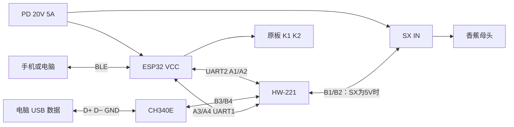

# Type-C 电源简化硬件接线表

V1.5 使用 PD、SX150C、ESP32 双继电器板、HW-221 电平转换板和紫色 CH340E Type-C 板。 [串口模块接线](串口模块接线.md)

**统一供电前提：CH340E 必须先隔离 USB VBUS 到板上 5V 的供电通路，才能接机内 5V。原板未处理前，不可把两路 5V 并接。** 本文为接线设计，未执行实物改线。

## 电源

| 起点 | 终点 |
| --- | --- |
| PD + | SX IN+、ESP32 VCC |
| PD − | SX IN−、ESP32 GND |
| SX OUT+ | 红色香蕉母头 |
| SX OUT− | 黑色香蕉母头 |

20V 只接 ESP32 的高压 VCC，不能接 5V 或 3V3。两块板合计共用 5A。SX 原风扇保持原插座供电，不接到 ESP32。

## 电平板电源及使能

| 起点 | 终点 |
| --- | --- |
| ESP32 板 3V3 | HW-221 VA |
| ESP32 板 5V | HW-221 VB、CH340E +5V（VBUS 隔离后） |
| ESP32 GPIO27 | HW-221 OE，OE 另以 10kΩ 下拉至 GND |
| ESP32 GND | HW-221 GND、CH340E GND、SX GND |
| 不接 | CH340E 3V3 / DTR，SX 通信 +5V |

## 通信

| ESP32 引脚 | HW-221 | 对端 |
| --- | --- | --- |
| GPIO18 TX，P2 9 | A1 ↔ B1 | SX RX；仅 SX 为 5V 时 |
| GPIO19 RX，P2 8 | A2 ↔ B2 | SX TX；仅 SX 为 5V 时 |
| GPIO32 TX，P1 7 | A3 ↔ B3 | CH340E RXD |
| GPIO33 RX，P1 10 | A4 ↔ B4 | CH340E TXD |
| GPIO27，按原板网名 | OE | 内部使能，不作为外设控制口 |

若 SX 实测为 3.3V，SX 与 ESP32 直接同电平交叉连接，A1/A2/B1/B2 不接 SX；CH340E 仍经 A3/A4/B3/B4 转换。v1.1.7 起 UART1 使用 921600、8N1，UART2 按 SX Modbus 设置。OE 上电保持低，电源与 UART 初始化完成后才置高。OE 只控制信号，不能代替 SX 输出开关。

## 继电器

| 功能 | 引脚 | 输出 |
| --- | --- | --- |
| K1 | GPIO16，已板载 | 高吸合、低释放；直接使用原板 NC/COM/NO |
| K2 | GPIO17，已板载 | 高吸合、低释放；与 K1 独立 |

## 初次设置与待确认项

- PD：A 款仅短接 4，或 B 款仅短接 1，使用前测得 20V。
- SX：固定 M0、上电输出关闭、OPP 初值 75W、OTP 初值 60℃、LVP 约 18V；电压和限流按负载设置并读回。
- 电脑与手机：BLE 使用相同 GATT；电脑有线走 UART1，SX 走 UART2。
- 实物接线前确认 SX 电平、CH340E 的 VBUS 隔离、HW-221 OE 条件；验证双继电器、BLE/USB 和新增板同时运行时的 5V/3V3 余量。
- 75W 输出目标下用外部仪表验证整机输入不超过 100W；这台设备不内置整机输入功率测量。

关断依赖 SX 本机或串口 ONOFF。ESP32 卡死或 SX 串口失联时可能保持先前输出，客户端应显示未知状态，不能显示为已关闭。
