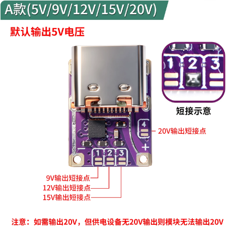
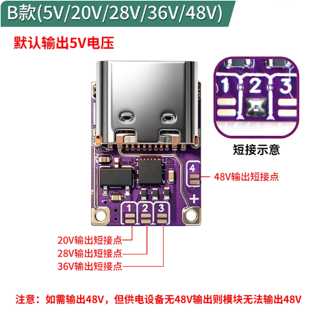

# Mini PD3.1 快充诱骗模块资料整理

来源：[芯路城资料页 608](https://www.xinlucity.com/?s=resourcedetail/index/id/608.html)。采集日期：2026 年 11 月 6 日。网页名称为“超小Mini PD3.1 快充诱骗模块（A/B 款）--客户资料”。

该模块通过 Type-C 与充电器协商固定电压，再从正负焊盘引出直流电。它没有升降压、恒流或电池充电管理功能。项目中的可调输出应由 SX150C 完成，PD 模块只负责提供输入母线。

## 本地资料

| 文件 | 用途 |
| --- | --- |
| [网页资料离线版](网页资料离线版.html) | 可离线查看的产品详情，产品图片已本地化，删除了网站脚本和导航 |
| [网页原始快照](网页原始快照.html) | 采集时服务器返回的完整 HTML，保留原始远程资源链接 |
| [来源清单](来源清单.json) | 采集时间、资源 URL、大小及 SHA256 校验值 |
| [A 款配置图](images/A款焊盘配置图.png) | A 款电压与焊盘位置 |
| [B 款配置图](images/B款焊盘配置图.png) | B 款电压与焊盘位置 |
| [产品主图](images/产品主图.png) | 网站产品图 |
| [原有尺寸简图](尺寸简图.png) | 项目原有图片，供外形参考 |

资料下载栏目在采集时显示“暂无内容”，页面没有提供可下载的说明书、原理图、芯片资料或通信协议附件。因此归档内容为网页详情、三张产品图片和来源记录。

## 网页标称参数

| 项目 | 网页标称值 |
| --- | --- |
| 产品版本 | A 款与 B 款 |
| 输入接口 | Type-C 母座 |
| 支持协议 | PD2.0、PD3.1 EPR、QC2.0 |
| 电压范围 | 两个版本合计覆盖 5、9、12、15、20、28、36、48V，具体见下表 |
| 最大电流 | 5A，实际还受充电器、线材及协商结果限制 |
| 外形 | 13 × 10 × 4mm |
| 工作温度 | 网页标称 −40～105℃，不能直接用作装机连续满载温度保证 |
| 直流输出 | “+”为正极，“−”为负极 GND |
| 选择方式 | 断电后用焊锡短接一组电压配置焊盘 |

## 焊盘配置

| 短接状态 | A 款目标电压 | B 款目标电压 |
| --- | --- | --- |
| 全部不短接 | 5V | 5V |
| 仅短接 1 | 9V | 20V |
| 仅短接 2 | 12V | 28V |
| 仅短接 3 | 15V | 36V |
| 仅短接 4 | 20V | 48V |

两个版本选择 20V 的焊盘不同。装配前必须核对实物版本与配置图，不能只凭项目原有示意图片认定版本。网页未规定多个焊盘同时短接时的有效编码，因此只允许短接一组。

## 使用条件

充电器必须实际支持所选档位。网页说明不支持目标档位时可能向下兼容；具体回退电压、启动时间和瞬态需要实测。28、36、48V 档位需要支持相应 EPR 档位的充电器及适配线材。网页的“5A”是模块标称上限，不表示任意档位、任意充电器均可取得 5A。

极性接错会损坏后端；负载电流同时受模块、线材和充电器约束。配置、补焊及改线均应在断电状态进行。该模块不能直接承担锂电池充电管理。

## 本项目采用方式

采用固定 20V 输入：A 款短接 4，或 B 款短接 1。首版优先选 A 款，可减少误配置到高压档位的机会。SX150C 标称输入上限为 36V，48V 禁止接入；36V 档位处于上限，缺少瞬态余量，也不采用。

100W 模式需要已经核验的单口 20V 5A 充电器、5A E-Marker C-C 线和本模块共同工作。建议用 PD 分析仪核对实际协商电流。这个网页没有提供协议电流读取接口、PG 信号或 MCU 控制接口；ESP32 不能靠检测到 20V 就推断可用功率为 100W。没有确认电流能力时禁止开放 5A 模式。

网页和项目原有图片均不足以确定固定孔中心距、连接器相对 PCB 的偏移和实际 PCB 厚度。

5A 线材条件可参考 [TI USB Type-C 线缆说明](https://www.ti.com/lit/pdf/ssztbj8)。详细系统设计见 [Type-C 可调直流电源详细设计书](../../docs/Type-C可调直流电源详细设计书.md)。
